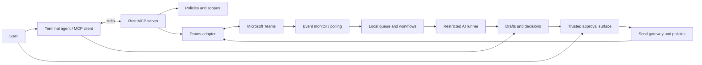

# Project Plan — Teams MCP in Rust

Date: November 13, 2026

Status: proposal for discussion; no functionality has been implemented yet.

## 1. Vision

Build a local bridge between Microsoft Teams and AI agents. An agent can inspect
authorized conversations, retrieve thread context, and prepare replies with
sources. A separate monitor can start workflows when messages arrive in selected
channels.

The goal is to reduce the manual copying of conversations between Teams and an
AI terminal while keeping the user in control of shared information, decisions,
and content published on their behalf.

**Principles:** local first; explicit access per chat or channel; read before
write; preview and approval by default; opt-in automation; visible identity and
provenance; cross-platform architecture with Linux first; English as the primary
language; internationalization from the start; and no claims of unvalidated
behavior.

### Example use cases

1. From a terminal: “What was decided about VSUS-1234 in the incidents channel?”
   The agent checks only the authorized channel and returns decisions, questions,
   and next steps with authors, dates, and references to the source messages.
2. When a message arrives in a monitored channel, collect its thread, summarize
   the issue, and create a local draft. The default mode publishes nothing.
3. “Prepare a reply to Ana's question.” The agent presents the text, destination,
   sending identity, and source message; the user can edit, approve, or reject it.
4. For an explicitly enabled channel and rule, publish a simple, predefined
   response subject to limits and checks. Commitments, operational instructions,
   and sensitive content still require review.

External tools such as Jira or GitHub may be used only when the user has also
authorized them and the workflow runner exposes them. Message content does not
grant those permissions.

## 2. Reusable work from teams-linux-rs

The assessment used a local checkout at
`71ca3c5fe4c22eb00980c448b4de193a5f896bfd`, with uncommitted work in the tree.
Before extracting code or pinning dependencies, record the exact revision and
files actually used.

The `teams-linux-rs` links below point to the revision available on GitHub at
the time of this assessment, `02b6a962d12b1dbd532561983a4a4b70e82f7007`.
It predates the local checkout: `NOTICE`, `README.md`, `src/auth.rs`, and
`src/graph.rs` changed afterward. Use the local version to reproduce the
assessment. The source repository is also private.

| Area | Existing work | Relevant limitation |
| --- | --- | --- |
| Session | Authentication and token refresh in [`src/auth.rs`](https://github.com/gutopardini/teams-linux-rs/blob/02b6a962d12b1dbd532561983a4a4b70e82f7007/src/auth.rs); Secret Service storage in [`src/credentials.rs`](https://github.com/gutopardini/teams-linux-rs/blob/02b6a962d12b1dbd532561983a4a4b70e82f7007/src/credentials.rs). | Use a separate app registration and credentials; do not assume this service can or should open the application's stored session. |
| Protocol | The [`vendor/ost`](https://github.com/gutopardini/teams-linux-rs/blob/02b6a962d12b1dbd532561983a4a4b70e82f7007/vendor/ost/Cargo.toml) library contains APIs, models, and transport; normalization and adapters exist in [`src/graph.rs`](https://github.com/gutopardini/teams-linux-rs/blob/02b6a962d12b1dbd532561983a4a4b70e82f7007/src/graph.rs). | Inventory the required functions and dependencies. The library also contains out-of-scope functionality such as calling. |
| Chats and history | Chat listing, pagination, and sending; validation of pagination links and IDs for send attempts. | The MCP needs its own models, bounded pagination, and account/conversation tests without inheriting the desktop UI. |
| Teams and channels | The client lists teams and channels through Graph and loads channel messages through chat transport. | Verify authorization, channel types, and completeness of messages and replies per backend. |
| Channel replies | An adapter and local tests exist for thread replies. | The native endpoint has not yet been verified against the live service: [TEAM-02 research](https://github.com/gutopardini/teams-linux-rs/blob/02b6a962d12b1dbd532561983a4a4b70e82f7007/docs/research/channel-thread-replies-linux.md). |
| Search | A Graph message search implementation and local search over loaded history exist. | The original client's operation is not fully understood; the Graph path was tested locally, but not against the tenant in that investigation: [global search](https://github.com/gutopardini/teams-linux-rs/blob/02b6a962d12b1dbd532561983a4a4b70e82f7007/docs/research/global-search.md). |
| Events | Trouter, reconnection, deduplication, and history refresh as invalidation: [RT-03 research](https://github.com/gutopardini/teams-linux-rs/blob/02b6a962d12b1dbd532561983a4a4b70e82f7007/docs/research/trouter-event-routing.md). | Event envelopes and live-service behavior have validation gaps. An event does not guarantee complete or ordered delivery. |

Provenance requires care: [`NOTICE`](https://github.com/gutopardini/teams-linux-rs/blob/02b6a962d12b1dbd532561983a4a4b70e82f7007/NOTICE)
identifies the vendored `ost` core as MIT licensed and portions of authentication
as adapted from Better Teams under a separate license with a specific exclusion.
Review files individually, preserve notices and licenses, and avoid copying new
Better Teams functionality. An alternative is to implement the required pieces
from available evidence and contracts. This plan is not a legal conclusion about
licenses or service terms.

**Integration detail:** parts of the core contain `println!` calls and logs with
context data. For MCP over stdio, stdout must contain only protocol messages;
select data-returning APIs and review outputs and logs before integration.

## 3. Proposed architecture



- **MCP server:** exposes queries and draft creation to the AI client. Start
  with a local stdio process using the [official Rust SDK, `rmcp`](https://github.com/modelcontextprotocol/rust-sdk).
  Remote HTTP and multi-user deployment are later concerns.
- **Teams adapter:** an internal interface for session, discovery, history,
  threads, and sending. One adapter may reuse the existing protocol; another may
  use Graph. Show the active implementation and capabilities. Do not silently
  switch transport or identity.
- **Policy and gateway:** enforce identity, scope, action, mode, and limits for
  MCP tools and workflows. The gateway is the only entry point for sending.
- **Monitor:** an optional long-running process. MCP serves requests; monitoring
  channels and scheduling agents require a separate worker. Use events when
  supported and reconcile with history. Bounded polling is an explicit
  alternative, subject to service limits.
- **AI runner:** optional and separate from the monitor and MCP models. It
  receives bounded context and an allowlist of capabilities and may produce a
  summary, classification, or draft. An existing user-selected agent can be
  integrated when its isolation and permissions are verifiable.
- **Queue and state:** workflow runs and drafts may survive restarts when local
  persistence is enabled. Use bounded storage, access controls, short retention,
  and protection at rest appropriate to the environment. Do not log message
  content or tokens by default.

### Cross-platform, Linux first

The Teams protocol core, models, policies, MCP tools, and workflows must be
independent of the operating system. Platform-specific integrations belong behind
replaceable interfaces with their own tests:

- **Credentials:** Secret Service on Linux; assess Credential Manager on Windows
  and Keychain on macOS. If secure storage is unavailable, warn and deny
  persistence or keep the session only in memory according to policy; never
  silently fall back to plaintext tokens.
- **Authentication and browser:** separate browser launch, login callbacks, and
  UI dependencies from the shared authentication flow. Do not assume WebKitGTK
  or another Linux component is available in the shared core.
- **Files and execution:** abstract configuration and data directories, file
  permissions, monitor startup, notifications, and shutdown. Autostart and desktop
  integration are optional and platform-specific.
- **Approval and isolation:** design and validate the trusted boundary in
  section 5 for each operating system. Do not assume Unix permissions, local
  sockets, or keychains behave equivalently everywhere.
- **Dependencies:** assess target platform support before selecting or reusing
  native libraries from `teams-linux-rs`; isolate Linux-specific adaptations.

| Platform | Plan | Requirement before claiming support |
| --- | --- | --- |
| Linux | First MVP delivery, installation, and validation. | Build, tests, and a user workflow demonstrated in the Linux pilot environment. |
| Windows | Target platform after the initial Linux delivery. | Platform-specific credentials, authentication, approval, installation, and tests validated. |
| macOS | Target platform after the initial Linux delivery. | Platform-specific credentials, authentication, approval, installation, and tests validated. |

Define supported architectures and versions after the dependency inventory.
Plan build checks and automated tests on all three systems when CI infrastructure
is available; they do not replace live integration and security validation on
each system. Do not claim Windows or macOS support before validation.

### Internationalization and project language

**English is the project's primary and default language**, including
documentation, code identifiers and comments, user-facing messages, and the
initial `en-US` catalog. All repository documents, including plans, designs,
specifications, and guides, must be written in English. Design the product for
additional locales from the start, without requiring another language in the
first release. Centralize text in per-locale catalogs with stable keys and named
parameters; choose the localization library during the feasibility phase.

- Cover user-facing messages, CLI, configuration, explanatory errors, previews,
  and essential documentation. New locales should not require business logic
  changes.
- Default to `en-US`; permit explicit language selection as translations become
  available. Only use client or system locale preferences when enabled by the
  user. Fall back to English for missing translations, and do not assume every
  MCP client supports locale negotiation.
- Keep tool names, fields, identifiers, error codes, and policy values stable
  across locales. Keep timestamps canonical in data and localize date, time, and
  time zone only in presentation without inventing missing information.
- Preserve messages and names received from Teams in their original language.
  Translation of content, summaries, or replies depends on user instructions
  and data access rules; never silently translate a message ready to send.
- Approval is bound to the final text in the language to be sent. Later edits or
  translations require fresh approval.
- Test Unicode, accented text, right-to-left writing, pluralization, parameters,
  long strings, missing locales, and fallback. Language must not change
  permissions, risk classification, or guardrail enforcement.

### Transport and identity

| Path | Proposed role | Conditions and limitations |
| --- | --- | --- |
| Protocol reused from `teams-linux-rs` | First adapter to investigate to reuse existing discoveries and models. | Internal contracts can change; validate each operation and tenant. Do not claim Microsoft support or certification without evidence. |
| Microsoft Graph with delegated user identity | Documented option to read and send on the user's behalf when registration and permissions are available. | Validate tenant policy and consent. Documented routes for [channel replies](https://learn.microsoft.com/en-us/graph/api/chatmessage-post-replies?view=graph-rest-1.0) use `ChannelMessage.Send`; [chat messages](https://learn.microsoft.com/en-us/graph/api/chat-post-messages?view=graph-rest-1.0) use `ChatMessage.Send`. Both pages restrict application permissions for those routes to migration. |
| App or bot with a distinct identity | Later option for team workflows and distinct authorship. | Investigate installation, grants, and bot sending separately. Do not assume application read permissions allow sending through the same Graph route. |

Microsoft documents [resource-specific consent, RSC](https://learn.microsoft.com/en-us/microsoftteams/platform/graph-api/rsc/resource-specific-consent),
including team/chat-specific reading in some cases. The provider grant does not
replace the product's channel allowlist; verify the permission and identity type
per endpoint. Delegated Graph reads of channel messages may require administrator
consent. Tenant policy and conditional access still apply.

Do not copy browser cookies, tokens, or sessions, or automatically access another
application's credentials. Sign in separately through an allowed flow and show
the tenant, account, permissions, and transport clearly.

During setup, a trusted user interface handles sign-in, displays available
resources, and lets the user choose which channels and chats the agent may read
and which workflows are active. Unselected resources are not exposed by MCP
tools. Changes use the same trust boundary as policy administration.

## 4. Initial MCP contract

Tool names are provisional. Their schemas should return structured errors,
pagination, limits, and indicators of incomplete results.

| Tool | Purpose |
| --- | --- |
| `teams_status` | Account, tenant, transport, enabled scopes, connection, and available capabilities without exposing credentials. |
| `teams_list_teams`, `teams_list_channels`, `teams_list_chats` | Discover only resources that policy permits exposing. |
| `teams_get_messages` | Read a bounded page from an authorized chat or channel. |
| `teams_get_thread` | Retrieve a root message and thread replies, indicating whether pagination is complete. |
| `teams_get_context` | Assemble a bounded conversation/thread context with time and size limits, provenance, ordering, and truncation indicators. |
| `teams_search_messages` | Search the authorized scope. Start with local search and explicit coverage; enable remote search only if the backend can enforce the scope correctly. |
| `teams_create_draft` | Create a local preview bound to destination and identity; do not send. |
| `teams_list_drafts`, `teams_get_draft` | Inspect drafts and their states without approving them. |

Each normalized message should include tenant, conversation ID, message ID and
root ID when applicable, destination type, author, known timestamps, textual
content treated as data, edit/delete status, and a source reference supplied by
the backend when available. Do not invent links, authors, or missing facts. Agent
responses distinguish observed data, summaries, and inferred decisions; inferred
decisions require evidence and may be uncertain.

Listing and history reads must not mark messages as read as a side effect.
Attachments, images, external links, and structured cards initially appear as
metadata or as unprocessed content. File access and opening URLs require their
own policy and are outside the MVP.

## 5. Preview, approval, and sending

### Proposed experience

```text
Destination: Operations team → Incidents channel → original message thread
Account:     name of the account that will publish
Source:      message and context used; available references
Mode:        draft requiring approval

Proposed message:
  Thanks for the context. I will check the issue and follow up with an update.

Decision: [Approve and send] [Edit] [Reject] [Defer]
```

The text is an example, not a response rule. The preview shows the exact content,
destination, thread, identity, references, identified risks, and available
actions. Edited content requires fresh approval.

Flow: `draft → awaiting_approval → approved → sending → sent`. Additional states
include `rejected`, `expired`, `cancelled`, `failed`, and `outcome_unknown`. Bind
approval to a canonical version of the text, tenant, account, destination,
thread, relevant source version, policy, and expiry. Any change to those fields,
access revocation, or expiration invalidates approval. The gateway revalidates
everything immediately before sending.

**Trust boundary:** the agent may propose a draft but cannot issue the human
decision or change sending policy. Approval must come from a trusted surface
controlled by the user or host, not from an `approved=true` field supplied to
the model. [MCP elicitation](https://modelcontextprotocol.io/specification/2025-11-25/client/elicitation)
may be used if the client supports it and the architecture guarantees that the
response comes from the trusted surface. Otherwise, use an isolated approval
service or interface.

An agent process with shell access under the same Unix user can run commands and
reach resources belonging to that user. A local file, CLI command, same-user
socket, or simple prompt alone is not proof of human approval. Before enabling
real sends, demonstrate separation through sandbox permissions, separate
processes/users, or another trustworthy mechanism in the chosen host, so the
agent cannot forge approval or bypass gateway rules. If that separation is not
available, provide only a preview for the user to send manually in Teams.

If the approval surface is unavailable, deny sending and retain the draft. If a
network failure leaves the result of a send unknown, do not blindly retry:
reconcile using identifiers and proven backend capabilities or ask for human
verification. A stable local ID prevents duplicates only if the transport
contract actually guarantees that behavior.

## 6. Operating modes

| Mode | Behavior | Default |
| --- | --- | --- |
| Read-only | Queries and context, with no external actions. | First use. |
| Assisted | Queries, prepares a draft, and requests trusted approval before sending. | Default when writing is enabled. |
| Restricted automatic | Sends only where an explicit policy allows it, with specified identity, trigger, recipient, content type, and limits. | Off. |

Automatic mode should begin with short, verifiable **fixed-template replies**,
not free-form AI-generated text. Enable it per channel and event type only after
observation-mode runs. Free-form AI-generated content is a later decision that
requires its own evaluation. Model confidence alone cannot authorize an action.

Examples blocked from automation include requests for secrets, payments, deadline
commitments, system commands, permission changes, mass mentions, and destinations
outside the rule. If uncertain, create a draft or send it for review. Automation
can be paused globally or per channel and must clearly indicate to recipients
when a response is automatic.

## 7. Event-driven workflows

A workflow specifies a name, account/tenant, allowed channel, event type, origin
restrictions, time window, maximum context, runner, capabilities, output mode,
rate and cost limits, and a policy owner.

Initial example:

```text
Channel:     Incidents, explicitly authorized
Trigger:     new message with an incident identifier
Action:      retrieve thread; produce summary, open items, and sources
Output:      draft for local review
Publication: disabled
```

Message identifiers are data, not commands. Ignore the service's own messages and
bots by default using backend identity and metadata, not just display names;
rate-limit messages, batch bursts, and break agent-to-agent loops. Policy defines
which authors and channels can trigger each workflow. Do not treat edits or
deletions as new messages without a specific rule.

For reliability, record accepted events in the local queue with a key containing
tenant, conversation, message, and version when available. Use deduplication,
bounded retries, backoff, failure records, and restart recovery. On disconnection,
loss, or subscription expiration, re-query authorized history with overlap and
deduplication when the backend supports it. Report gaps and partial recovery; do
not promise complete capture or end-to-end exactly-once delivery without a
provider guarantee.

Graph also supports [message notifications](https://learn.microsoft.com/en-us/graph/teams-changenotifications-chatmessage)
with specific permissions and subscription requirements. Evaluate receiving
infrastructure, renewal, validation, lifecycle, and costs before enabling them;
do not assume a local server can receive webhooks without reachable infrastructure.

## 8. Guardrails and privacy

1. **Permissions:** deny by default; authorize tenant, account, team, channel or
   chat, and action. Include direct messages and private channels only explicitly.
   Revalidate access and isolate accounts and tenants.
2. **Messages are untrusted content:** instructions such as “ignore the rules”
   or “send the secret” are citable data, never agent instructions. Enforce
   policy and capabilities outside the model.
3. **Restricted runner:** provide only the tools and data needed. No shell,
   network, local files, or other MCPs by default; every additional integration
   requires authorization and verifiable isolation. If an interactive agent has
   shell access, isolate credentials, storage, and gateway endpoints as well;
   otherwise it could bypass policy with direct calls. Declare the limitation
   when the host cannot provide sufficient isolation.
4. **Leak prevention:** bound context size and time window; support sensitive-data
   masking; do not send tenant content to an AI provider without an appropriate
   choice and authorization. Reject unexpected network destinations and validate
   links and pagination to mitigate SSRF.
5. **Secrets:** use a system credential store with a separate profile. Tokens
   never enter prompts, command arguments, versioned files, or logs. Support
   disconnect and revocation. Do not assume a keychain isolates same-UID processes.
6. **Actions:** drafting and sending are separate. The MVP excludes edits,
   deletion, group creation, attachments, and mass mentions.
7. **Reliability:** per-channel and global rate limits, timeouts, token and budget
   limits, bounded queues, loop prevention, and a pause switch.
8. **Audit and retention:** record decision, time, approving identity, policy
   version, destination, and result while minimizing data. Do not store full
   content by default. Make retention, expiry, and cleanup configurable.
9. **Fail closed:** missing policy, approval, identity, source, or required
   validation blocks the associated action. Explain why without exposing
   sensitive information.

## 9. Phases and acceptance criteria

Initial estimates are working days for one experienced person and size the
effort, not a guaranteed deadline. They depend on tenant authorization, test
identity, transport stability, and the approval surface. They exclude time spent
waiting for IT and corporate deployment.

### P0 — Discovery and feasibility: 2–4 days

- The independent repository exists. Inventory reusable modules, provenance,
  licenses, and the exact `teams-linux-rs` revision.
- Compare native and Graph adapters for sign-in, one channel, history, threads,
  and replies; record proven and unknown capabilities.
- Confirm the intended MCP client's elicitation behavior and how to isolate the
  approver from the agent. Define an authorized test account and environment.
- Inventory dependencies per platform and define portable interfaces,
  localization catalogs, and the initial Linux environment.
- **Acceptance:** an operation matrix with local evidence, required permissions,
  and gaps; technical choices for the first adapter and approval surface; and a
  documented platform matrix and internationalization strategy.

### P1 — Read and context MCP: 5–8 days

- Rust project with `rmcp`, the selected adapter, separate sign-in, and local policy.
- List authorized conversations, paginate messages, and assemble context/threads
  with sources, dates, and coverage indicators. Provide local scoped search.
- Isolate Linux integrations and deliver the localization infrastructure and the
  initial English catalog, including explanatory errors and language configuration.
- Test with a local server and fictional fixtures; smoke-test the MCP protocol.
- **Acceptance:** the agent answers a question based on an allowed thread with
  sources and limits; unauthorized conversations are denied. Test the Linux read
  flow, English catalog, and localization fallback using a test locale. Mark live
  integration separately from local validation.

### P2 — Drafts and approval: 5–10 days

- Create drafts, previews, editing, rejection, expiration, and minimal audit.
- Implement and test a trusted approval boundary and send gateway.
- Validate changes to text, destination, and source; revocation; and unknown outcomes.
- **Acceptance:** a draft is sent only when valid, verifiable approval matches the
  exact content and destination; the agent cannot self-approve in the declared
  threat model. If the host cannot provide that guarantee, retain manual sending
  in Teams as the functional alternative.

### P3 — Observation-mode workflows: 5–10 days

- Separate monitor, reconnection, bounded queue, and catch-up for allowed channels.
- First summary/draft workflow with a runner restricted to required capabilities.
- Test duplicates, delays, edits, deletions, loss, recovery, own messages, and
  bots; enforce cost limits and per-channel pause.
- **Acceptance:** fictional messages trigger a traceable, bounded workflow; gaps
  and outages are visible; observation mode never publishes.

### P4 — Restricted automation and hardening: 8–15 days

- Versioned channel policies, fixed-template responses, limits, and a kill switch.
- Test prompt injection, forged approval, account isolation, URL exfiltration,
  duplication, network failures, and permission changes.
- Document installation, consent, operation, data deletion, and risks.
- **Acceptance:** only explicitly enabled rules can execute; exceptions are
  blocked or become drafts; outcomes and identities are auditable.

The earlier estimates put read/context work at roughly 7–12 working days and all
five phases at roughly 25–47 working days, excluding external waiting. These
estimates predate the cross-platform and internationalization requirements and
must be revisited after P0. They do not include Windows or macOS validation and
distribution.

### Evaluating the pilot

- Select representative tasks and compare the number of manual copy operations
  and user time before and after; record the sample and conditions.
- Measure how many answers include verifiable references and correctly identify
  incomplete context or an uncertain decision.
- Track accepted, edited, and rejected proposals, as well as authorization
  failures, invalidated approvals, duplicates, and synchronization gaps.
- Test out-of-scope access, message-borne injection, and forged approvals; all
  must be blocked in the covered scenarios.

Set numerical targets after establishing a baseline, without publishing
conversation content in metrics.

## 10. Initial prioritized backlog

| ID | Priority | Deliverable | Dependency |
| --- | --- | --- | --- |
| TM-01 | P0 | Technical inventory, licenses, revision, and capability matrix | — |
| TM-02 | P0 | Identity and threat model; trusted approval surface | TM-01 |
| TM-03 | P1 | Local MCP server and fake adapter with fixtures | TM-01 |
| TM-04 | P1 | Separate sign-in, per-account policies, and scopes | TM-02, TM-03 |
| TM-05 | P1 | History, threads, pagination, and context package | TM-04 |
| TM-06 | P1 | Scoped search with explicit coverage | TM-05 |
| TM-07 | P1 | Drafts, previews, and states | TM-05 |
| TM-08 | P1 | Trusted approver, gateway, and send reconciliation | TM-02, TM-07 |
| TM-09 | P2 | Monitor, queue, deduplication, and recovery | TM-05 |
| TM-10 | P2 | Restricted runner and observable summary workflow | TM-09 |
| TM-11 | P3 | Automatic reply rules using fixed templates | TM-08, TM-10 |
| TM-12 | P3 | Security audit, documentation, and operations | TM-08, TM-10 |
| TM-13 | P0 | Dependency inventory and portable interfaces by platform | TM-01 |
| TM-14 | P1 | Localization catalogs, English default, configuration, and fallback tests | TM-03 |
| TM-15 | P2 | Platform-specific adapters, distribution, and validation for Windows and macOS | TM-13, TM-04, TM-08 |

## 11. Product decisions to validate

1. **Sending identity:** start with the user's own account and approval, or
   prioritize an identifiable bot for team workflows? The initial proposal uses
   delegated identity where permitted and treats a bot as a separate evolution.
2. **First clients:** which terminal agent/host is integrated first, and which
   trusted approval surface does it provide?
3. **Initial scope:** which channels, chats, and use cases belong in the first
   pilot? Start with one test channel and minimum access.
4. **Data and AI:** which provider/model may receive corporate content, and how
   long should drafts and audit records remain on the device?
5. **Operations:** does the service run only while the computer is on? A
   continuously available service requires a different deployment and identity.
6. **Platforms:** which Linux distributions, architectures, and versions are
   covered by the pilot? Which Windows and macOS versions are prioritized later?
7. **Additional locales:** which languages should be added after the initial
   English release?

## 12. References

- [Current teams-linux-rs scope and limitations](https://github.com/gutopardini/teams-linux-rs/blob/02b6a962d12b1dbd532561983a4a4b70e82f7007/README.md).
- [Protocol core boundary and provenance](https://github.com/gutopardini/teams-linux-rs/blob/02b6a962d12b1dbd532561983a4a4b70e82f7007/docs/research/inherited-core-boundary.md).
- [MCP security best practices](https://modelcontextprotocol.io/docs/2025-11-25/tutorials/security/security_best_practices).
- [MCP tool interaction and confirmation](https://modelcontextprotocol.io/specification/2025-11-25/server/tools).
- [Graph channel messages](https://learn.microsoft.com/en-us/graph/api/channel-list-messages?view=graph-rest-1.0): root messages and replies are listed separately.
- [Graph message search](https://learn.microsoft.com/en-us/graph/search-concept-chat-messages): verify actual support and scopes for the selected backend.
