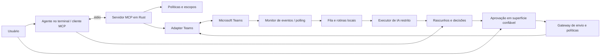

# Planejamento — Teams MCP em Rust

Data: 13 de novembro de 2026

Estado: proposta para discussão; nenhuma funcionalidade foi implementada neste projeto.

## 1. Visão

Criar uma ponte local entre o Microsoft Teams e agentes de IA. O agente poderá
consultar conversas autorizadas, recuperar o contexto de um tópico e preparar
respostas com fontes. Um monitor separado poderá iniciar rotinas quando chegarem
mensagens nos canais escolhidos.

O objetivo é reduzir o trabalho de copiar conversas entre o Teams e o terminal,
mantendo o usuário no controle da informação compartilhada, das decisões e do
que é publicado em seu nome.

**Princípios:** local primeiro; acesso explícito por conversa ou canal; leitura
antes de escrita; prévia e aprovação por padrão; automação opt-in; identidade e
origem visíveis; e nenhuma promessa de comportamento ainda não validado.

### Exemplos de uso

1. No terminal: “O que foi decidido sobre a VSUS-1234 no canal de incidentes?”
   O agente consulta somente o canal autorizado e devolve decisões, dúvidas e
   próximos passos com autor, data e referência às mensagens.
2. Na chegada de uma mensagem em um canal monitorado: reunir o tópico, resumir
   o problema e criar um rascunho local. Nada é publicado automaticamente no
   modo padrão.
3. “Prepare uma resposta para a pergunta da Ana.” O agente apresenta o texto,
   destino, identidade de envio e mensagem de origem; o usuário pode editar,
   aprovar ou rejeitar.
4. Para um canal e uma regra explicitamente habilitados: publicar uma resposta
   simples e predefinida, respeitando limites e verificações. Compromissos,
   instruções operacionais e conteúdo sensível continuam exigindo revisão.

O processamento pode usar ferramentas externas, como Jira ou GitHub, apenas se
o usuário também as tiver autorizado e o executor da rotina as expuser. O texto
de uma mensagem não concede essas autorizações.

## 2. Base reaproveitável do teams-linux-rs

Levantamento feito no checkout local, cujo `HEAD` era
`71ca3c5fe4c22eb00980c448b4de193a5f896bfd`, com alterações de trabalho não
commitadas. Antes de extrair ou fixar dependências, registrar a revisão e os
arquivos efetivamente usados.

Os links para o `teams-linux-rs` abaixo apontam para a revisão disponível no
GitHub na data deste levantamento, `02b6a962d12b1dbd532561983a4a4b70e82f7007`.
Ela é anterior ao checkout local analisado: `NOTICE`, `README.md`, `src/auth.rs`
e `src/graph.rs` mudaram depois. Consulte a versão local para reproduzir a
análise; o repositório de origem também é privado.

| Área | O que já existe | Limite relevante |
| --- | --- | --- |
| Sessão | Fluxos de autenticação e renovação em [`src/auth.rs`](https://github.com/gutopardini/teams-linux-rs/blob/02b6a962d12b1dbd532561983a4a4b70e82f7007/src/auth.rs); armazenamento no Secret Service em [`src/credentials.rs`](https://github.com/gutopardini/teams-linux-rs/blob/02b6a962d12b1dbd532561983a4a4b70e82f7007/src/credentials.rs). | Usar registro de aplicativo e credenciais próprios; não pressupor que o novo serviço possa ou deva abrir a sessão salva pelo aplicativo. |
| Protocolo | Biblioteca [`vendor/ost`](https://github.com/gutopardini/teams-linux-rs/blob/02b6a962d12b1dbd532561983a4a4b70e82f7007/vendor/ost/Cargo.toml), com APIs, modelos e transporte; dados normalizados/adaptações em [`src/graph.rs`](https://github.com/gutopardini/teams-linux-rs/blob/02b6a962d12b1dbd532561983a4a4b70e82f7007/src/graph.rs). | Inventariar as funções necessárias e suas dependências. A biblioteca inclui funcionalidades fora do escopo, como chamadas. |
| Chats e histórico | Listagem, paginação e envio no cliente; validação dos links de paginação e IDs de tentativa no código existente. | O MCP precisa de modelos próprios, paginação limitada e testes por conta/conversa, sem herdar a interface gráfica. |
| Equipes e canais | O cliente lista equipes/canais por Graph e carrega mensagens do canal pelo transporte de chat. | Confirmar autorização, tipos de canal e completude de mensagens e respostas para cada backend. |
| Respostas em canal | Há adapter e testes locais para respostas em tópico. | O endpoint nativo ainda não foi confirmado no serviço real: [pesquisa TEAM-02](https://github.com/gutopardini/teams-linux-rs/blob/02b6a962d12b1dbd532561983a4a4b70e82f7007/docs/research/channel-thread-replies-linux.md). |
| Busca | Há implementação Graph para pesquisar mensagens e busca local no histórico carregado. | A operação do cliente original não foi completamente descoberta; o caminho Graph foi testado localmente, mas não no tenant naquela pesquisa: [busca global](https://github.com/gutopardini/teams-linux-rs/blob/02b6a962d12b1dbd532561983a4a4b70e82f7007/docs/research/global-search.md). |
| Eventos | Trouter, reconexão, deduplicação e atualização de histórico como invalidação: [pesquisa RT-03](https://github.com/gutopardini/teams-linux-rs/blob/02b6a962d12b1dbd532561983a4a4b70e82f7007/docs/research/trouter-event-routing.md). | Envelopes e operação no serviço real têm limites de validação. Um evento não é garantia de entrega completa ou ordenada. |

A proveniência exige atenção: [`NOTICE`](https://github.com/gutopardini/teams-linux-rs/blob/02b6a962d12b1dbd532561983a4a4b70e82f7007/NOTICE) registra o
núcleo `vendor/ost` como MIT e partes de autenticação como adaptadas de Better
Teams sob outra licença, com exclusão específica. Avaliar arquivo por arquivo,
preservar avisos e licenças e evitar copiar novas funcionalidades do Better
Teams. A alternativa é implementar as peças necessárias com base nas evidências
e nos contratos disponíveis. Este plano não é uma conclusão jurídica sobre as
licenças ou os termos do serviço.

**Detalhe de integração:** partes do núcleo contêm `println!` e logs com dados
de contexto. Em MCP via stdio, a saída padrão precisa conter somente mensagens
do protocolo; selecionar APIs de dados e revisar logs/saídas antes de integrá-las.

## 3. Arquitetura proposta



- **Servidor MCP:** expõe consultas e criação de rascunhos ao cliente de IA.
  Começar com `stdio`, processo local e o [SDK oficial Rust `rmcp`](https://github.com/modelcontextprotocol/rust-sdk).
  HTTP remoto e implantação multiusuário ficam para depois.
- **Adapter Teams:** interface interna com operações de sessão, descoberta,
  histórico, tópicos e envio. Um adapter pode aproveitar o protocolo já
  implementado; outro pode usar Graph. A implementação ativa e suas capacidades
  devem ser explícitas. Não trocar silenciosamente de transporte ou identidade.
- **Políticas e gateway:** verificam identidade, escopo, ação, modo e limites
  tanto nas ferramentas MCP quanto nas rotinas. Ser a única entrada para
  operações de envio.
- **Monitor:** processo de longa duração opcional. MCP sozinho atende chamadas;
  não é, por si só, um serviço que observa canais nem agenda agentes. O monitor
  usa eventos se o transporte os suportar e reconcilia com histórico; polling
  limitado é alternativa explícita, respeitando limites do serviço.
- **Executor de IA:** opcional, separado do monitor e dos modelos MCP. Recebe
  contexto delimitado e uma lista de capacidades permitidas; pode produzir
  resumo, classificação e rascunho. Pode integrar um agente já usado pelo
  usuário, desde que o isolamento e as permissões sejam verificáveis.
- **Fila e estado:** execução e rascunhos podem sobreviver a reinícios quando o
  usuário habilitar persistência local. Usar armazenamento limitado, controles
  de acesso e retenção curta; proteger dados em repouso com mecanismo adequado
  ao ambiente. Não registrar conteúdo e tokens em logs por padrão.

### Transportes e identidade

| Caminho | Papel proposto | Condições e limitações |
| --- | --- | --- |
| Protocolo aproveitado do `teams-linux-rs` | Primeiro adapter a investigar para aproveitar a descoberta e os modelos já existentes. | Contratos internos podem mudar; validar por operação e por tenant. Não chamar de suportado ou homologado pela Microsoft sem evidência. |
| Microsoft Graph com usuário delegado | Opção documentada para leitura e envio em nome do usuário, quando o registro e as permissões estiverem disponíveis. | Validar consentimento e política do tenant. A rota documentada para [responder em canal](https://learn.microsoft.com/en-us/graph/api/chatmessage-post-replies?view=graph-rest-1.0) usa `ChannelMessage.Send`; a de [enviar em chat](https://learn.microsoft.com/en-us/graph/api/chat-post-messages?view=graph-rest-1.0) usa `ChatMessage.Send`. Ambas as páginas restringem permissões de aplicação daquela rota à migração. |
| Aplicativo/bot com identidade própria | Alternativa futura para rotinas de equipe e autoria distinta. | Requer investigação específica de instalação, concessões e fluxo de envio de bot. Não presumir que permissões de leitura de um aplicativo permitam enviar pela mesma rota Graph. |

A Microsoft documenta [consentimento específico por recurso, RSC](https://learn.microsoft.com/en-us/microsoftteams/platform/graph-api/rsc/resource-specific-consent),
inclusive leitura por equipe/chat em alguns cenários. O escopo do consentimento
do provedor não substitui a lista de canais permitidos no produto; confirmar a
permissão e o tipo de identidade para cada endpoint. Leitura delegada de
mensagens de canal no Graph, por exemplo, pode exigir consentimento
administrativo. Restrições de TI e acesso condicional continuam valendo.

Não copiar cookies, tokens ou sessões de navegador, nem acessar as credenciais
de outro aplicativo automaticamente. Fazer login separado com o fluxo permitido
e mostrar claramente tenant, conta, permissões e transporte.

Na configuração inicial, uma interface confiável para o usuário faz o login,
mostra os recursos disponíveis e permite escolher quais canais e chats o agente
poderá consultar e quais rotinas serão ativadas. Os recursos não selecionados
não são expostos pelas ferramentas MCP. A alteração dessas escolhas deve usar
a mesma fronteira de confiança definida para a administração das políticas.

## 4. Contrato MCP inicial

As ferramentas têm nomes provisórios; seus esquemas devem retornar erros
estruturados, paginação, limites e indicação do que ficou incompleto.

| Ferramenta | Função |
| --- | --- |
| `teams_status` | Conta, tenant, transporte, escopos habilitados, conexão e capacidades disponíveis, sem revelar credenciais. |
| `teams_list_teams`, `teams_list_channels`, `teams_list_chats` | Descobrir apenas o que a política permite expor. |
| `teams_get_messages` | Ler página limitada de uma conversa ou canal autorizado. |
| `teams_get_thread` | Buscar mensagem raiz e respostas de um tópico, indicando se a paginação está completa. |
| `teams_get_context` | Montar um pacote limitado por conversa/tópico, período e quantidade, com procedência, ordenação e eventual truncamento. |
| `teams_search_messages` | Pesquisar no escopo autorizado; no início, admitir busca local com cobertura explícita. Só habilitar busca remota se o backend permitir aplicar o escopo corretamente. |
| `teams_create_draft` | Criar prévia local vinculada a destino e identidade; não envia. |
| `teams_list_drafts`, `teams_get_draft` | Consultar rascunhos e seus estados, sem aprová-los. |

Cada mensagem normalizada deve incluir tenant, identificador da conversa,
identificador da mensagem e da raiz quando houver, tipo de destino, autor,
datas conhecidas, conteúdo textual tratado como dado, estado de edição/exclusão
e referência de origem fornecida pelo backend quando disponível. Não inventar
links, autores ou fatos ausentes. A resposta ao agente distingue dados
observados, resumo e decisão inferida; decisões inferidas precisam de evidências
e podem ser classificadas como incertas.

Listas e histórico não devem marcar mensagens como lidas por efeito colateral.
Anexos, imagens, links externos e cartões estruturados entram inicialmente como
metadados ou indicação de conteúdo não processado; leitura de arquivos e
abertura de URLs exigem política própria e ficam fora do MVP.

## 5. Prévia, aprovação e envio

### Experiência proposta

```text
Destino:     Equipe Operações → Canal Incidentes → tópico da mensagem original
Conta:       nome da conta que vai publicar
Origem:      mensagem e contexto utilizados; referências disponíveis
Modo:        rascunho com aprovação

Mensagem proposta:
  Obrigado pelo contexto. Vou verificar o caso e retorno com uma atualização.

Decisão: [Aprovar e enviar] [Editar] [Rejeitar] [Adiar]
```

O texto é exemplo, não uma regra de resposta. A prévia deve mostrar o conteúdo
exato, destino, tópico, identidade, referências, riscos identificados e ações
possíveis. Se houver edição, o conteúdo editado precisa de nova aprovação.

Fluxo: `rascunho → aguardando aprovação → aprovado → enviando → enviado`.
Também existem `rejeitado`, `expirado`, `cancelado`, `falhou` e
`resultado_desconhecido`. Vincular a aprovação a uma versão canônica do texto,
tenant, conta, destino, tópico, versão relevante da origem, política e prazo.
Mudança nesses elementos, revogação de acesso ou expiração invalida a aprovação.
O gateway revalida tudo imediatamente antes de enviar.

**Fronteira de confiança:** o agente pode propor um rascunho, mas não pode
emitir a decisão humana nem mudar a política de envio. A aprovação deve chegar
por uma superfície confiável controlada pelo usuário/host, não por um campo
`approved=true` fornecido ao modelo. [MCP elicitation](https://modelcontextprotocol.io/specification/2025-11-25/client/elicitation)
pode ser usado se o cliente suportar o recurso e a arquitetura garantir que a
resposta vem da superfície confiável. Caso contrário, usar serviço/interface de
aprovação isolado.

Um processo de agente com shell e o mesmo usuário Unix pode executar comandos e
alcançar recursos do mesmo usuário. Um arquivo local, comando CLI, socket do
mesmo usuário ou simples prompt não são, isoladamente, prova de aprovação humana.
Antes de habilitar envio real, demonstrar separação por sandbox/permissões,
processos/usuários distintos ou outro mecanismo confiável no host escolhido,
de modo que o agente não consiga forjar a aprovação nem acessar o gateway fora
das regras. Se essa separação não existir, oferecer somente a prévia para o
usuário enviar manualmente no Teams.

Na indisponibilidade da superfície de aprovação, negar o envio e manter o
rascunho. Em falha de rede após a tentativa, não repetir automaticamente um
envio cujo resultado seja desconhecido: reconciliar usando identificador e
capacidades comprovadas do backend ou pedir verificação humana. Um ID local
estável só evita duplicatas se o contrato do transporte realmente o garantir.

## 6. Modos de operação

| Modo | Comportamento | Padrão |
| --- | --- | --- |
| Leitura | Consultas e contexto, sem ações externas. | Primeiro uso. |
| Assistido | Consulta, prepara rascunho e solicita aprovação confiável antes do envio. | Padrão quando escrita estiver habilitada. |
| Automático restrito | Envia somente onde uma política específica permitir, com identidade, gatilho, destinatário, tipo de conteúdo e limites definidos. | Desligado. |

O modo automático deve começar com **respostas de modelo fixo**, curtas e
verificáveis, não com texto livre gerado por IA. Somente habilitar por canal e
tipo de evento após execução em modo de observação. Conteúdo livre gerado por
IA é uma decisão futura, sujeita a avaliação própria. Uma pontuação de confiança
do modelo, sozinha, não autoriza uma ação.

Exemplos de bloqueio para automação: pedidos de dados sigilosos, pagamentos,
promessas de prazo, comandos para sistemas, mudanças de permissão, menções em
massa ou envio a destinatário fora da regra. Se houver dúvida, gerar rascunho ou
encaminhar para revisão. A automação pode ser pausada globalmente ou por canal,
e deve indicar claramente ao destinatário quando a resposta for automática.

## 7. Rotinas orientadas a eventos

Uma rotina reúne: nome, conta/tenant, canal permitido, tipo de evento,
restrições de origem, janela de tempo, contexto máximo, executor, capacidades,
modo de saída, limites de frequência/custo e responsável pela política.

Exemplo inicial:

```text
Canal:       Incidentes, explicitamente autorizado
Gatilho:     mensagem nova com identificador de incidente
Ação:        recuperar tópico e produzir resumo + pendências + fontes
Saída:       rascunho para revisão local
Publicação:  desativada
```

Os identificadores das mensagens são dados, não comandos. Ignorar mensagens do
próprio serviço e de bots por padrão, usando identidade e metadados do backend,
não apenas o nome exibido; limitar mensagens por intervalo, agrupar rajadas e
interromper ciclos entre agentes. A política define quais autores e canais
podem acionar cada rotina. Não tratar edit/delete como mensagem nova sem regra.

Para robustez, registrar eventos aceitos na fila local com chave por tenant,
conversa, mensagem e versão quando disponível. Usar deduplicação, retentativas
limitadas, backoff, registro de falhas e recuperação após reinício. Ao detectar
desconexão, perda ou expiração de assinatura, consultar novamente o histórico
no escopo permitido, com sobreposição e deduplicação quando o backend suportar.
Expor lacunas e recuperação parcial; não prometer captura completa ou entrega
exatamente uma vez ponta a ponta sem garantia do provedor.

O Graph também oferece [notificações de mensagens](https://learn.microsoft.com/en-us/graph/teams-changenotifications-chatmessage),
com permissões e operação de subscriptions específicas. Avaliar infraestrutura
de recebimento, renovação, validação, ciclo de vida e custos antes de incluí-las;
não pressupor que um servidor local receba webhooks sem infraestrutura acessível.

## 8. Guardrails e privacidade

1. **Permissões:** negar por padrão; autorizar tenant, conta, equipe, canal ou
   chat e ação. DMs e canais privados só por inclusão explícita. Revalidar acesso
   e manter fronteiras entre contas e tenants.
2. **Mensagem é conteúdo não confiável:** instruções como “ignore as regras” ou
   “envie o segredo” são dados citáveis, nunca instruções ao agente. A política
   e as capacidades são aplicadas fora do modelo.
3. **Executor limitado:** a rotina recebe somente ferramentas e dados
   necessários. Sem shell, rede, arquivos locais ou outros MCPs por padrão;
   cada integração adicional requer autorização e isolamento verificáveis. Se
   o agente interativo tiver shell, separar também o acesso às credenciais,
   armazenamento e endpoints do gateway; caso contrário ele poderia contornar
   a política com chamadas diretas. Declarar essa limitação quando o host não
   oferecer isolamento suficiente.
4. **Proteção contra vazamento:** limitar janela e tamanho do contexto; permitir
   mascaramento de dados sensíveis; não enviar conteúdo ao provedor de IA sem
   escolha e autorização adequadas para os dados do tenant. Rejeitar destinos de
   rede inesperados e validar links/paginação para mitigar SSRF.
5. **Segredos:** cofre de credenciais do sistema com perfil próprio; tokens
   nunca entram em prompts, argumentos, arquivos versionados ou logs. Permitir
   revogar/desconectar. Não assumir que o chaveiro isola processos do mesmo UID.
6. **Ações:** criar rascunho e enviar são operações distintas. Sem edição,
   exclusão, criação de grupo, anexos ou menções em massa no MVP.
7. **Confiabilidade:** controle de taxa por canal e global, timeout, limite de
   tokens e orçamento, fila limitada, prevenção de loops e chave de pausa.
8. **Auditoria e retenção:** registrar decisão, data, identidade autorizadora,
   versão da política, destino e resultado com minimização de dados. Não gravar
   conteúdo completo por padrão. Tornar retenção, descarte e limpeza configuráveis.
9. **Falha fechada:** ausência de política, aprovação, identificação, origem ou
   validação necessária impede a ação correspondente; explicar o motivo ao
   usuário sem expor dados sensíveis.

## 9. Etapas e critérios de aceite

Estimativas iniciais em dias úteis de uma pessoa experiente, para dimensionar
esforço, não como prazo garantido. Dependem de autorização do tenant, identidade
de teste, estabilidade dos transportes e definição da superfície de aprovação.
Não incluem espera por TI nem implantação corporativa.

### P0 — Descoberta e prova de viabilidade: 2–4 dias

- Criar repositório independente e inventariar os módulos reutilizáveis,
  proveniência/licenças e revisão exata do `teams-linux-rs`.
- Comparar adapter nativo e Graph para login, um canal, histórico, tópico e
  resposta; anotar capacidades comprovadas e desconhecidas.
- Confirmar como o cliente MCP pretendido trata elicitation e como isolar o
  aprovador do processo do agente. Definir conta e ambiente de teste autorizados.
- **Aceite:** matriz por operação com evidência local, permissão necessária e
  lacunas; decisão técnica para o primeiro adapter e para o aprovador.

### P1 — MCP de leitura e contexto: 5–8 dias

- Projeto Rust com `rmcp`, adapter selecionado, login separado e política local.
- Listar conversas autorizadas, paginar mensagens e montar contexto/tópico com
  fonte, datas e indicação de cobertura. Busca local no escopo permitido.
- Testes com servidor local e fixtures fictícias; smoke test de protocolo MCP.
- **Aceite:** agente consegue responder a uma pergunta baseada em um tópico
  permitido, apresentando fontes e limites; conversas não autorizadas são negadas.
  Integração real é marcada separadamente da validação local.

### P2 — Rascunhos e aprovação: 5–10 dias

- Criar rascunho, prévia, edição, rejeição, expiração e auditoria mínima.
- Implementar e testar fronteira confiável de aprovação e gateway de envio.
- Validar mudança de texto/destino/origem, revogação e resultado desconhecido.
- **Aceite:** rascunho só é enviado quando uma aprovação válida e verificável
  corresponde ao conteúdo e destino exatos; agente não consegue aprová-lo por
  conta própria no cenário de ameaça declarado. Se o host não permitir essa
  garantia, manter envio manual no Teams como alternativa funcional.

### P3 — Rotinas em modo de observação: 5–10 dias

- Monitor independente, reconexão, fila limitada e catch-up por canal permitido.
- Primeira rotina de resumo/rascunho com executor de capacidades reduzidas.
- Testar mensagens repetidas, atraso, edição, exclusão, perda, retomada e
  mensagens próprias/de bots; limite de custo e pausa por canal.
- **Aceite:** mensagens fictícias acionam uma rotina rastreável e delimitada;
  quedas e lacunas ficam visíveis; nenhuma publicação acontece nesse modo.

### P4 — Automação restrita e endurecimento: 8–15 dias

- Políticas versionadas por canal, resposta fixa, limites e desligamento rápido.
- Testar prompt injection, tentativas de forjar aprovação, isolamento de contas,
  exfiltração por URL, duplicação, falhas de rede e mudanças de permissão.
- Documentar instalação, consentimentos, operação, exclusão de dados e riscos.
- **Aceite:** apenas regras explicitamente habilitadas conseguem executar;
  exceções são bloqueadas ou viram rascunho; resultado e identidade são auditáveis.

Com essas hipóteses, leitura e contexto ocupam aproximadamente 7–12 dias úteis;
as cinco etapas somam aproximadamente 25–47 dias úteis,
além de eventuais esperas externas. Os intervalos devem ser revistos após P0.

### Como avaliar o piloto

- Selecionar tarefas representativas e comparar o número de cópias manuais e o
  tempo gasto pelo usuário antes e depois; registrar a amostra e as condições.
- Medir quantas respostas apresentam referências verificáveis e quantas
  sinalizam corretamente contexto incompleto ou uma decisão incerta.
- Acompanhar propostas aceitas, editadas e rejeitadas, além de falhas de
  autorização, aprovações invalidadas, duplicatas e lacunas de sincronização.
- Testar explicitamente as tentativas de acesso fora do escopo, injeção por
  mensagem e aprovação forjada; todas devem ser bloqueadas nos cenários cobertos.

Estabelecer metas numéricas após uma linha de base, sem publicar conteúdo de
conversas nos indicadores.

## 10. Backlog inicial priorizado

| ID | Prioridade | Entrega | Dependência |
| --- | --- | --- | --- |
| TM-01 | P0 | Inventário técnico, licenças, revisão e matriz de capacidades | — |
| TM-02 | P0 | Modelo de identidade, ameaça e superfície de aprovação confiável | TM-01 |
| TM-03 | P1 | Servidor MCP local e adapter fake com fixtures | TM-01 |
| TM-04 | P1 | Login separado, políticas por conta e escopos | TM-02, TM-03 |
| TM-05 | P1 | Histórico, tópico, paginação e pacote de contexto | TM-04 |
| TM-06 | P1 | Busca limitada com cobertura explícita | TM-05 |
| TM-07 | P1 | Rascunho, prévia e estados | TM-05 |
| TM-08 | P1 | Aprovador confiável, gateway e reconciliação de envio | TM-02, TM-07 |
| TM-09 | P2 | Monitor, fila, deduplicação e recuperação | TM-05 |
| TM-10 | P2 | Executor restrito e rotina de resumo observável | TM-09 |
| TM-11 | P3 | Regras de resposta automática com template fixo | TM-08, TM-10 |
| TM-12 | P3 | Auditoria de segurança, documentação e operação | TM-08, TM-10 |

## 11. Decisões de produto a validar

1. **Identidade de envio:** começar com a própria conta e aprovação, ou priorizar
   um bot identificado para rotinas de equipe? A proposta inicial usa conta
   delegada quando permitida e mantém bot como evolução separada.
2. **Primeiros clientes:** qual agente/host de terminal precisa ser integrado
   primeiro e qual superfície confiável ele oferece para aprovação?
3. **Escopo inicial:** quais canais, chats e casos de uso devem ser autorizados
   no primeiro piloto? A proposta começa com um canal de teste e acesso mínimo.
4. **Dados e IA:** qual provedor/modelo pode receber conteúdo corporativo e por
   quanto tempo rascunhos e auditoria devem permanecer no dispositivo?
5. **Operação:** o serviço roda somente enquanto o computador está ligado? Um
   serviço sempre disponível exige outra implantação e decisões de identidade.

## 12. Referências

- [Visão e limites atuais do teams-linux-rs](https://github.com/gutopardini/teams-linux-rs/blob/02b6a962d12b1dbd532561983a4a4b70e82f7007/README.md).
- [Fronteira e proveniência do núcleo de protocolo](https://github.com/gutopardini/teams-linux-rs/blob/02b6a962d12b1dbd532561983a4a4b70e82f7007/docs/research/inherited-core-boundary.md).
- [Regras de segurança do MCP](https://modelcontextprotocol.io/docs/2025-11-25/tutorials/security/security_best_practices).
- [Interação e confirmação de ferramentas MCP](https://modelcontextprotocol.io/specification/2025-11-25/server/tools).
- [Mensagens de canal no Graph](https://learn.microsoft.com/en-us/graph/api/channel-list-messages?view=graph-rest-1.0): a listagem de mensagens raiz e a das respostas são operações distintas.
- [Busca de mensagens no Graph](https://learn.microsoft.com/en-us/graph/search-concept-chat-messages): confirmar suporte e escopos efetivos no backend escolhido.
